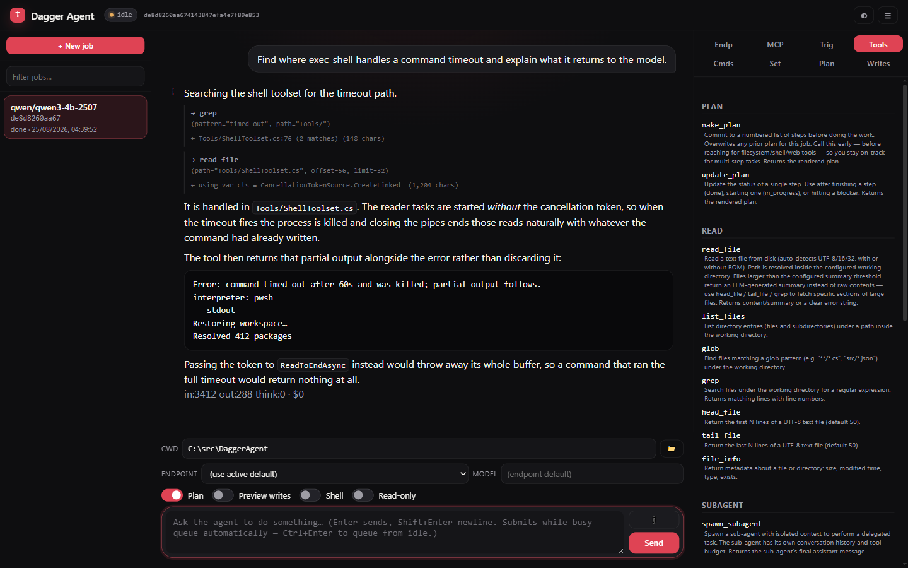

# DaggerAgent

A pure-C# .NET 10 LLM agent that talks to OpenAI-compatible, Anthropic and Ollama endpoints, or drives the Claude Code / Codex / Copilot CLIs as its model. Runs as an interactive terminal UI (TUI), a one-shot CLI, an HTTP service, an ACP agent, or a [Banter](https://github.com/Wixely/Banter) room agent — and is deployable as a Windows Service or a Docker container.



> Status: scaffolded. Wiring is in place for MCP clients, resumable jobs (SQLite), context compression, and sub-agents. Real-world testing and feature polish in progress.

## Features

- **Modes**: interactive TUI, one-shot CLI, HTTP service (Kestrel), ACP (JSON-RPC over stdio for editors), and [Banter mode](#banter-mode) — DaggerAgent as an agent in a Banter chat room, with one-time-code enrolment and key-backed identity.
- **Multi-protocol upstream client**: `OpenAI` (OpenAI itself, Azure OpenAI, LM Studio, vLLM, OpenRouter, any OpenAI-compatible endpoint), `Anthropic` (native Messages API), `Ollama` (native `/api/chat` via OllamaSharp), or `ClaudeCli` / `CodexCli` / `CopilotCli` (each turn shells out to the installed CLI and reuses its existing auth — no API key). Configure several under `Endpoints:Items` and pick a default with `Endpoints:DefaultId`; jobs can pin their own. A config with no `Endpoints` section falls back to the single `OpenAI:Provider` setting. Same code, swappable transport.
- **MCP client**: connects to any number of MCP servers over HTTP (streamable-HTTP transport) **or** stdio (child process); their tools are surfaced to the LLM alongside the built-in tools. See [MCP servers](#mcp-servers).
- **Built-in tools**:
  - **Always available (read-only safe)**: `read_file`, `list_files`, `glob`, `grep`, `head_file`, `tail_file`, `file_info`, `pwd`, `which`, `list_processes`, `http_get`, `spawn_subagent`, `recall_past_work` (if memory enabled).
  - **Opt-in via `Tools:AllowWrite`**: `write_file`, `edit_file`, `delete_file`, `move_file`, `copy_file`, `create_directory`, `remember` (if memory enabled). Off by default.
  - **Opt-in via `Tools:AllowShell`**: `exec_shell` with `shell` parameter (auto/cmd/powershell/pwsh/bash/sh). Off by default.
  - **`Tools:ReadOnly=true`** is a master kill-switch: blocks every mutating tool regardless of the AllowWrite/AllowShell flags. Useful for "let the agent investigate but never change anything" runs.
- **Diff-preview mode** (`Tools:WritePreview=true`): `write_file`/`edit_file` stage proposed changes and return a unified diff instead of writing; agent (or caller) must call `confirm_write` to apply. Adds `list_pending_writes` and `discard_write` tools.
- **API-key auth on inbound HTTP**: populate `Auth:ApiKeys` (or `DAGGER_Auth__ApiKeys__0`) to require an `X-Api-Key` header (or `Authorization: Bearer <key>`) on every request. Empty list = auth disabled (dev default). `/agent/healthz`, `/api/version`, `/v1/models` bypass the check.
- **Token + cost tracking**: real BPE counting (o200k Tiktoken) drives compression triggers. Every turn logs input/output/total tokens and per-model USD cost; cumulative totals surface on `JobView.totalInputTokens` / `totalOutputTokens` / `totalCostUsd`.
- **Cross-session memory (opt-in)**: `Memory:Enabled=true` activates a `recall_past_work` tool and an automatic save of every compression summary as an embedded memory. Embeddings (`Memory:EmbeddingModel`) are fetched through the legacy `OpenAI` section's `Provider` / `BaseUrl` / `ApiKey` — not through `Endpoints` — so keep that section pointing at a server that can embed. The vector store lives in the same SQLite database.
- **Structured questions (`ask_user`)**: the agent can ask whoever is driving the job a question with clickable options — rendered inline in the web transcript (buttons + free text), and as numbered options answered from the input line in the interactive TUI. With nobody attached (CLI one-shot, trigger jobs, Banter rooms — which have their own `ask_operator`) the tool answers immediately that no one is there to ask. Wait bounded by `Tools:AskUserTimeoutSeconds` (default 300).
- **Interactive hotkeys**: F1 shows the provider, model, tool counts, MCP server status and the job's token and cost totals; F2 lists slash commands; F3 opens a recent-sessions picker so you can resume by number instead of typing a job id; F8 resumes the most recent job started in the current directory (only before you send the first message).
- **Source-control triggers**: in service mode DaggerAgent can poll GitHub / GitLab / Azure DevOps via MCP servers and spawn an agent job per fresh ticket. Discovery uses the MCP server's `list_issues` / `list_mentions_since` / `query_work_items` tools **directly** — no LLM in the discovery path, so it's deterministic and free. Matches are deduplicated in the local SQLite via a `trigger_seen` table; each fresh match seeds a regular agent job that then has the same MCP server's action tools available for the actual work. Configure via the **Trig** tab in the web UI (recommended — see [Source-control triggers](#source-control-triggers)) or by editing `Triggers` in `appsettings.json`.
- **Resumable jobs**: every turn is persisted to a local SQLite database; resume by job id.
- **Context compression**: when token usage exceeds a threshold, older history is summarised via the LLM itself and replaced by a single summary message.
- **Sub-agents**: the agent can spawn child agents with isolated context and budgets (depth + turn caps).
- **Windows Service / Docker** ready.

## Quick start

Grab a zip from the [Releases page](https://github.com/Wixely/DaggerAgent/releases), or run the
published image `ghcr.io/wixely/daggeragent` — see [docs/install.md](docs/install.md) for both,
for running as a Windows Service, and for building from source.

```bash
# Interactive TUI
dagger

# CLI one-shot
dagger run --prompt "Summarise the README in two sentences"

# HTTP service
dagger serve
curl http://localhost:5090/agent/healthz
```

From a source checkout, use `dotnet run --` in place of `dagger`.

Open `http://localhost:5090/agent/ui` for the web interface. It is one responsive page:
on a phone the side panes become bottom sheets, the configuration tabs fold behind
*Advanced*, and the composer collapses to a single context line. `/agent/mobile` was a
separate shell until it was merged in; the path still redirects to `/agent/ui` so older
bookmarks keep working.

## Configuration

Configuration is layered: `appsettings.json` → `appsettings.{Env}.json` → `appsettings.Local.json` → environment variables (no prefix) → environment variables with `DAGGER_` prefix → command-line arguments.

Secrets (`OpenAI:ApiKey`, endpoint `ApiKey`s, MCP `AuthHeader`) belong in `appsettings.Local.json` (gitignored) or environment variables such as `DAGGER_OpenAI__ApiKey`. Anything you enter in the web UI — endpoint keys included — is saved in plain text to `data/runtime-config.json` beside the executable, and that file wins over `appsettings*.json` once it exists. Restrict access to it.

The default committed config points at LM Studio on `http://localhost:1234/v1` with model `qwen3.5:122b` — change as needed.

### Endpoints

Upstream models are configured as a list of endpoints — most easily in the web UI's **Endp**
tab, or under `Endpoints` in config. Each has an `Id`, a `Provider` (`OpenAI`, `Anthropic`,
`Ollama`, `ClaudeCli`, `CodexCli`, `CopilotCli`), a `BaseUrl`, an `ApiKey` and a
`DefaultModel`; `DefaultId` picks the one jobs use unless they pin another. For example, a local
Ollama server alongside Anthropic:

```jsonc
{
  "Endpoints": {
    "DefaultId": "ollama",
    "Items": [
      { "Id": "ollama", "DisplayName": "Local Ollama", "Provider": "Ollama",
        "BaseUrl": "http://localhost:11434", "DefaultModel": "llama3.1:8b" },
      { "Id": "claude", "DisplayName": "Claude", "Provider": "Anthropic",
        "ApiKey": "sk-ant-...", "DefaultModel": "claude-opus-4-7" }
    ]
  }
}
```

(Note the Ollama URL does **not** end in `/v1` — that's only for its OpenAI-compat shim. Use `http://localhost:11434` for the native protocol.)

Optional per-endpoint fields: `MaxContextTokens` (size compression to this model's window
instead of the global `Agent:CompressionThreshold`), `MaxOutputTokens`, `RequestTimeoutSeconds`,
and `Enabled` (hide it from the UI without deleting it).

With no `Endpoints` section at all, DaggerAgent falls back to the single endpoint described by
the `OpenAI` section (`Provider`, `BaseUrl`, `ApiKey`, `DefaultModel`) — which is what the
committed `appsettings.json` uses.

## MCP servers

DaggerAgent connects to MCP servers via two transports. There's no explicit `Type` field — the transport is chosen by which fields are set:

- **HTTP** (streamable-HTTP transport) — when `Url` is set. The server is contacted at that URL; pass an `Authorization` header value via `AuthHeader`.
- **stdio** (child process) — when `Url` is empty and `Command` is set. DaggerAgent spawns the command as a subprocess and speaks MCP over the child's stdin/stdout. This is how most published MCP servers ship (npm `@modelcontextprotocol/server-*`, the GitHub MCP server, Python MCP servers, etc.).

If both `Url` and `Command` are set, `Url` wins.

```jsonc
{
  "Mcp": {
    "Servers": [
      // HTTP — a remote / sidecar MCP server that exposes an HTTP endpoint.
      {
        "Name": "github-http",
        "Url": "http://localhost:5101/mcp",
        "AuthHeader": "Bearer my-token"
      },
      // stdio — npx-launched filesystem server, passing the allowed root as an arg.
      {
        "Name": "fs",
        "Command": "npx",
        "Arguments": [ "-y", "@modelcontextprotocol/server-filesystem", "C:\\Users\\me\\projects" ]
      },
      // stdio — uvx-launched Python MCP server with extra env vars and a working dir.
      {
        "Name": "search",
        "Command": "uvx",
        "Arguments": [ "mcp-server-fetch" ],
        "WorkingDirectory": "C:\\tools",
        "EnvironmentVariables": { "HTTP_PROXY": "http://proxy.local:8080" }
      }
    ]
  }
}
```

Tool names are surfaced to the LLM as `mcp.{Server-Name}.{tool}`; e.g. the filesystem server above would offer `mcp.fs.read_file`, `mcp.fs.list_directory`, etc.

## Banter mode

`dagger banter` runs DaggerAgent as an agent inside a [Banter](https://github.com/Wixely/Banter)
room server: it logs in as an ordinary Banter user, joins rooms, and answers with its own LLM/tool
loop — tools, sub-agents, job persistence and all. The SDK decides *when* to speak (delegation,
@mentions, egress rules); DaggerAgent decides *what* to say. Each room holds its own conversation.

The room's own tools ride along with DaggerAgent's registry on every turn, sourced from the SDK's
`ToolsFor(room)` and dispatched back through it: `ask_operator` (a structured question the room
answers by clicking, bounded by `Banter:AskTimeoutSeconds`), the delegator's `open_side_room` /
`invite_agent`, and whatever tools the Banter server granted. `Banter:RoomTools=false` withholds
them — worth it for an unattended fleet, where an unanswerable ask would just block turns on the
timeout.

### Enrolling (recommended)

An operator creates the agent in the Banter desktop client's **agents page** and is handed a
one-time enrolment code. Redeem it once, on the machine that will run the agent:

```bash
dagger banter --enrol banter-enrol-XXXXXXXXXXXXXXXXXXXXXXXXXXX --server tcp://host:7770
```

This generates a P-256 keypair locally, sends only the public half, and keeps the private key at
`Banter:KeyFile` (default `banter.key` beside the executable — **DPAPI-protected for the current
user on Windows**, user-only file permissions elsewhere). It prints the identity and its **key
fingerprint** — how an operator tells one machine from another — and exits. The code is spent
either way. After that the agent logs in by signing a server-chosen nonce: the credential never
travels, a captured login cannot be replayed, and deleting or reissuing the agent server-side
revokes it immediately.

An existing key file is never overwritten — reissuing a key is an explicit move-aside, because the
server still holds the public half and nothing can reproduce the private one. A truncated or
foreign key file is reported as itself before connecting, not as "invalid credentials".

### Managing it from the web UI

In service mode (`dagger serve`) the same connection is managed from the web UI's **Bant** tab —
no second process. It shows the live connection (state, identity, rooms, key fingerprint, last
error) with **Connect** / **Disconnect** buttons, a box to paste an enrolment code into (the
enrolled nick and fingerprint come back, and the config is updated to match), and the full
config section — server, rooms, LLM endpoint + model for room turns, routing attributes,
auto-connect on service start. Edits persist to `runtime-config.json` and apply on the next
connect. Enrolment and connection state are also scriptable at `/agent/banter`
(`GET`, `POST /config`, `POST /enrol`, `POST /connect`, `POST /disconnect`).

The status is honest about outages. A dropped connection shows **reconnecting (attempt n)**
while the SDK redials with jittered backoff — on success it re-authenticates (fresh signed
nonce), rejoins its rooms and re-announces its attributes by itself. Auto-connect retries a
server that is still booting the same way. The card also shows the attributes the server
actually **granted** next to the requested ones, flagging when an admin override is in effect.
The one terminal state is **evicted**: the identity was revoked or reissued server-side, and
reconnecting cannot help — deliberately nothing retries out of it; move the old key aside and
enrol again with a fresh code.

### Running standalone

```bash
dagger banter                       # settings from the Banter config section
dagger banter --user scribe --rooms "#main,#dev"
```

```jsonc
{
  "Banter": {
    "Server": "tcp://127.0.0.1:7770",
    "User": "dagger",
    "KeyFile": "banter.key",       // from --enrol; or set Password for the legacy route
    "Rooms": [ "#main" ],
    "Locality": "local",           // "frontier" if this DaggerAgent drives a hosted API
    "Clearance": "sensitive",      // public | internal | sensitive
    "Skills": [ "code", "tools" ], // what the room's delegator routes on
    "EndpointId": "",              // LLM endpoint for room turns; empty = active default
    "Model": "",                   // empty = the endpoint's default model
    "SystemPrompt": "",            // empty = Agent prompt + a group-chat addendum
    "AutoConnect": false           // service mode: connect at startup
  }
}
```

The routing attributes (`Rooms`, `Locality`, `Clearance`, `Skills`, `Description`, `CostTier`,
`WantsDelegator`) are **requests**, announced to the server on connect — not guarantees. The
Banter server has the final say: an admin's agent settings, delegator election, the room's
dispatch mode, clearance rules and rate guardrails can override or refuse any of them. The agents
page in the Banter client shows what actually applies.

A configured `Password` still works for an agent that has one, but is refused when a key file also
exists — whichever silently won, the other would be the stale credential nobody noticed.

## Source-control triggers

A background poller (`Triggers:Enabled=true`) scans configured ticket sources every `PollIntervalSeconds` and spawns an agent job per fresh match. Discovery calls the MCP server's tools directly — the LLM is only invoked once a match needs to be acted on.

**Configuration paths**

- **Web UI (recommended)** — open the **Trig** tab, set scalar options at the top, then **+ Add source** for each repo/project. Changes write to `data/runtime-config.json` and the running `TriggerService` picks them up on the next cycle — no restart.
- **appsettings.json** — same shape under the `Triggers` section; useful for first-boot defaults or version-controlling the config. Runtime-config overrides win once it exists.

**Prerequisites**

1. At least one MCP server connected (under the **MCP** tab) that talks to your forge. Your MCPSharp servers (github / gitlab / azdo) already expose the needed tools.
2. (Optional) an endpoint configured in the **Endp** tab if you want to route triggered jobs to a specific model or CLI agent.

**Per-source fields**

| Field         | Purpose                                                                                                                 |
| ------------- | ----------------------------------------------------------------------------------------------------------------------- |
| `Id`          | Stable id used for dedup state. Free-form, e.g. `gh-triage`.                                                            |
| `Kind`        | `GitHub` / `GitLab` / `AzureDevOps`. Picks the call shape against the MCP server.                                       |
| `Mode`        | `Mentions` (phrase in body/comments), `Label`, `Assignee`, or `AllNew` (every fresh issue).                             |
| `Filter`      | Mode-specific value: phrase for Mentions, label name for Label, username for Assignee, ignored for AllNew.              |
| `McpServer`   | Name of an entry in `Mcp.Servers` — the one that exposes the relevant tools for this forge.                             |
| `Scope`       | `owner/repo` for GitHub, `group/project` for GitLab, project name for Azure DevOps. Empty = MCP server's default.       |
| `EndpointId`  | Optional. Pin this source's jobs to a specific endpoint (e.g. a `ClaudeCli` / `CodexCli` endpoint). Empty = global default. |
| `Model`       | Optional. Model override passed through to the chosen endpoint. Empty = endpoint's `DefaultModel`.                       |

**Top-level fields**

| Field                  | Purpose                                                                                            |
| ---------------------- | -------------------------------------------------------------------------------------------------- |
| `Enabled`              | Master on/off. Toggling is hot — the poller picks it up on the next cycle.                         |
| `PollIntervalSeconds`  | Cycle interval. Minimum 5s in code; 120s is a sensible default.                                    |
| `Phrase`               | Global `Mentions` default when a source doesn't set `Filter`.                                      |
| `AllowedAuthors`       | Empty = anyone can drive the agent (not recommended in production). Match is case-insensitive.     |
| `MaxJobsPerCycle`      | Backstop against a flood of matches burning through tokens. Counted across all sources per cycle.  |
| `JobPreamble`          | Prefix prepended to every triggered job's seed prompt. Use it for project context or playbook nudges. |

**Example (`appsettings.json`)**

```jsonc
{
  "Triggers": {
    "Enabled": true,
    "PollIntervalSeconds": 120,
    "Phrase": "@dagger",
    "AllowedAuthors": [ "Wixely" ],
    "MaxJobsPerCycle": 5,
    "JobPreamble": "You were triggered by a ticket. Read the details below, decide whether to act, and proceed.",
    "Sources": [
      // Every issue tagged `ai-triage` in this repo, handled by the Claude Code CLI endpoint.
      { "Id": "gh-triage", "Kind": "GitHub", "Mode": "Label", "Filter": "ai-triage",
        "McpServer": "github", "Scope": "Wixely/DaggerAgent",
        "EndpointId": "claude-cli-pro", "Model": "claude-opus-4-7" },

      // Every comment containing "@dagger" on any open issue in this GitLab project.
      { "Id": "gitlab-mentions", "Kind": "GitLab", "Mode": "Mentions", "Filter": "@dagger",
        "McpServer": "gitlab", "Scope": "group/project" },

      // Every work item assigned to dagger-bot, default endpoint.
      { "Id": "azdo-bugs", "Kind": "AzureDevOps", "Mode": "Assignee", "Filter": "dagger-bot",
        "McpServer": "azdo", "Scope": "MyProject" }
    ]
  },
  "Mcp": {
    "Servers": [
      { "Name": "github", "Url": "http://localhost:5101/mcp" },
      { "Name": "gitlab", "Url": "http://localhost:5102/mcp" },
      { "Name": "azdo",   "Url": "http://localhost:5089/mcp" }
    ]
  }
}
```

**Hot-reload semantics**

`TriggerService` re-reads its `IOptions<TriggerOptions>` snapshot on every cycle, so edits via the UI (or hand-edits to `data/runtime-config.json`) take effect on the next iteration. Toggling `Enabled` off doesn't kill the loop — the service idles and resumes when you turn it back on. The dedup cursor (last-polled timestamp) is per-source and persists in the SQLite job DB, so flipping a source off and on later won't re-process old tickets.

## Running as a Windows Service or in Docker

See [docs/install.md](docs/install.md#as-a-windows-service) for the `sc.exe` setup and
[docs/install.md](docs/install.md#docker) for the published image, its volumes, and building it
yourself.

## License

MIT.
